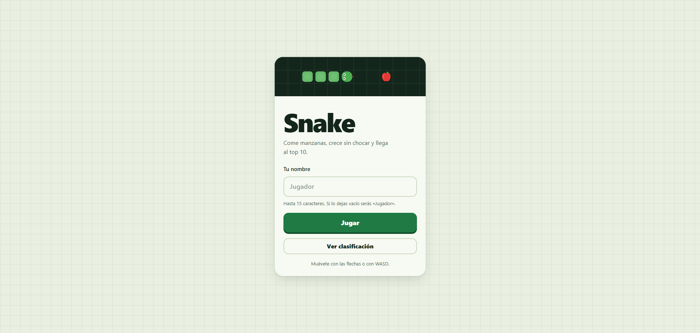
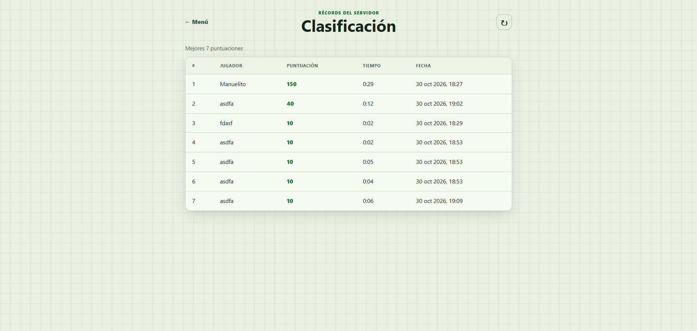
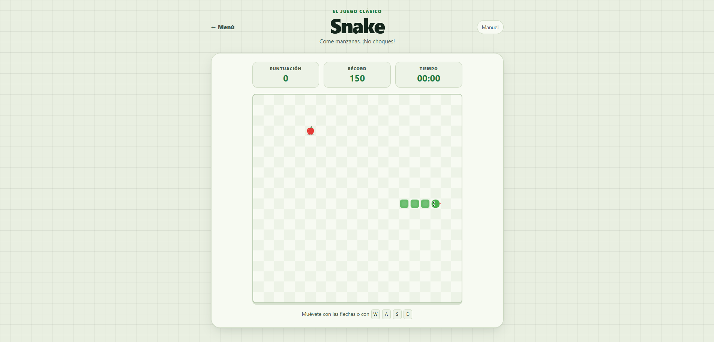
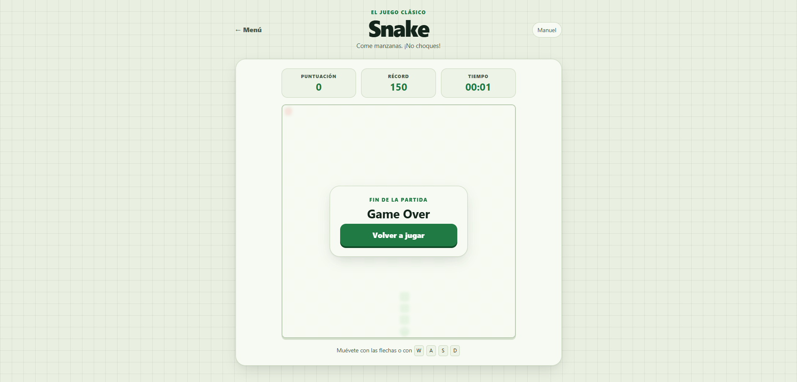

# Snake Game

Aplicación web de estilo arcade para jugar Snake con una interfaz multi-página, lógica del juego en JavaScript y almacenamiento de puntuaciones en MongoDB.

## Capturas de pantalla

<p align="center">
  
  
</p>
<p align="center"><strong>Pantalla principal</strong> · <strong>Clasificación</strong></p>

<p align="center">
  
  
</p>
<p align="center"><strong>Partida en curso</strong> · <strong>Fin de partida</strong></p>

## Descripción

Este proyecto implementa una experiencia clásica de Snake en navegador con:

- Pantalla principal de inicio
- Vista de juego con canvas
- Ranking de mejores puntuaciones
- Backend en Node.js con Express
- Persistencia de resultados en MongoDB

## Objetivo

Crear una aplicación web retro que combine un juego sencillo y fiable con una estructura organizada, buena separación de responsabilidades y una API para guardar puntuaciones.

## Arquitectura

La aplicación está compuesta por tres vistas principales:

1. Inicio o menú principal
   - Bienvenida al usuario
   - Entrada de nickname
   - Acceso a jugar y consultar puntuaciones

2. Pantalla del juego
   - Tablero renderizado con canvas
   - Movimiento, alimentación, colisiones y sistema de puntuación
   - Control de pausa y fin de partida
   - Envío de la puntuación al backend

3. Leaderboard
   - Consulta del ranking de jugadores
   - Visualización de los mejores resultados
   - Navegación de vuelta al menú principal

## Stack tecnológico

- Frontend: HTML5, CSS3, JavaScript ES6+
- Backend: Node.js + Express
- Base de datos: MongoDB con Mongoose

## Modelo de datos

```json
{
  "playerName": "String (máximo 15 caracteres, por defecto: Jugador)",
  "score": "Number (obligatorio)",
  "durationSeconds": "Number (obligatorio)",
  "createdAt": "Date (generado automáticamente)"
}
```

## API REST

| Método | Endpoint | Descripción |
| :--- | :--- | :--- |
| GET | `/api/scores` | Obtiene las 10 mejores puntuaciones ordenadas de mayor a menor. |
| POST | `/api/scores` | Registra una nueva puntuación al finalizar una partida. |

## Estructura del proyecto

```text
snake-game/
├── db/
│   ├── controllers/
│   │   └── scoreController.js
│   ├── models/
│   │   └── Score.js
│   ├── routes/
│   │   └── scoreRoutes.js
│   └── server.js
├── public/
│   ├── assets/
│   ├── css/
│   │   ├── game.css
│   │   ├── leaderboard.css
│   │   ├── main.css
│   │   └── style.css
│   ├── js/
│   │   ├── game.js
│   │   └── leaderboard.js
│   └── pages/
│       ├── game.html
│       ├── index.html
│       └── leaderboard.html
├── readme-assets/
│   ├── game-no-start.png
│   ├── game-start.png
│   ├── leaderboard.png
│   └── main.png
├── .env
├── .gitignore
├── package.json
├── package-lock.json
└── README.md
```

## Requisitos

- Node.js y npm
- MongoDB en ejecución

## Instalación

1. Clona el repositorio:

```bash
git clone https://github.com/Manueel8944/snake-game.git
cd snake-game
```

2. Instala las dependencias:

```bash
npm install
```

3. Configura las variables de entorno en un archivo `.env`:

```env
PORT=3000
MONGODB_URI=mongodb://localhost:27017/snake-game
```

4. Inicia el servidor desde la raíz del proyecto:

```bash
npm start
```

Durante el desarrollo, puedes usar `npm run dev` para reiniciar el servidor automáticamente cuando haya cambios.

5. Con el servidor en ejecución, abre otra terminal en la raíz del proyecto y ejecuta el comando correspondiente a tu sistema operativo:

Linux:

```bash
npm run open-l
```

Windows:

```bash
npm run open-w
```

## Uso

- El comando de apertura lleva a la página principal en `http://localhost:3000/pages/index.html`.
- Registra un nickname en la pantalla principal.
- Juega, acumula puntos y guarda el resultado al finalizar la partida.
- Consulta el ranking desde la vista de puntuaciones.

## Estado del proyecto

El proyecto incluye las vistas de inicio, juego y clasificación, además de un servidor Express y persistencia de puntuaciones en MongoDB.
